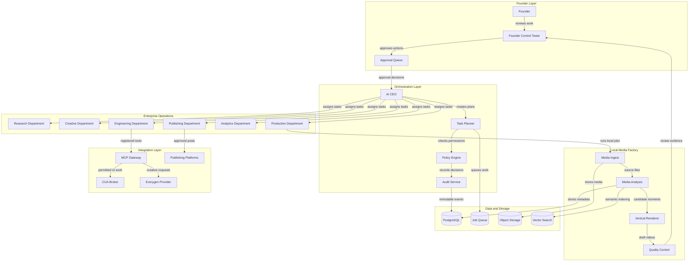
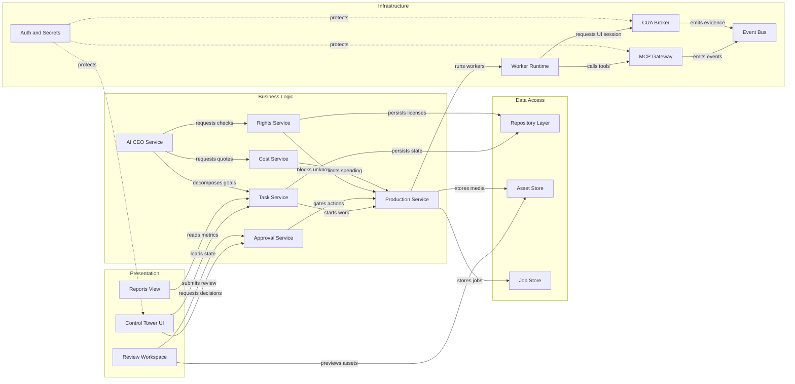

# GTA 6 Shorts Factory Architecture

This document defines the proposed architecture for the Founder Control Tower, AI enterprise orchestration, local media factory, MCP integrations, Everygen.ai provider, and guarded CUA automation. It is a target design for implementation and must be validated against the actual selected tools during Phase 0.

## Application Architecture

<!-- mermaid-checked: no \n, no em-dash/en-dash, no {} in labels, subgraphs are id["label"], arrows are -->|"label"|, all subgraphs closed by end, ids unique -->


### Technology Stack Summary

| Layer | Technology | Version | Purpose |
|---|---|---:|---|
| Dashboard | React or Next.js | To be selected | Founder Control Tower interface |
| API | FastAPI or typed Node API | To be selected | Dashboard, workers, approvals, and integrations |
| Orchestration | Typed workflow service | To be selected | AI CEO, departments, task state, retries |
| Database | PostgreSQL | Current supported release | Tasks, approvals, rights, assets, audits, analytics |
| Queue | Redis or PostgreSQL queue | To be selected | Durable asynchronous work |
| Object storage | MinIO or S3-compatible storage | Current supported release | Source media, renders, evidence, backups |
| Media processing | FFmpeg and ffprobe | Current stable release | Inspect, transform, encode, and normalize media |
| Speech to text | Whisper or faster-whisper | Current supported release | Local transcription and caption timing |
| Local AI | Ollama or llama.cpp | Current supported release | Drafting, scoring, classification, and metadata |
| Search | pgvector or local vector store | To be selected | Similarity search and duplicate detection |
| Integration protocol | Model Context Protocol | Current specification | Typed tool discovery and invocation |
| Remote creative provider | Everygen.ai adapter | Provider dependent | Optional image, video, audio, or director generation |
| Desktop automation | Isolated CUA broker | To be selected | Auditable UI fallback when an allowed API is unavailable |
| Observability | Structured logs and traces | To be selected | Diagnostics, evidence, and operational monitoring |

### Data Storage and External Services

PostgreSQL is the system of record for business entities, tasks, approvals, rights records, provider jobs, publishing state, and audit events. Object storage holds original media, derived renders, transcripts, thumbnails, screenshots, and evidence. The queue schedules long-running work without blocking the dashboard. Vector search is optional and supports semantic retrieval and duplicate detection. Everygen.ai is an optional remote provider accessed through the MCP gateway or its documented official integration. YouTube, TikTok, and other platforms are accessed through official APIs where possible; CUA is permitted only as an isolated, logged fallback for workflows that allow it.

### Key Architectural Decisions

- MCP is the primary integration and tool-control plane; CUA is replaceable fallback infrastructure.
- Local media processing must work without Everygen.ai, so provider outage or pricing changes do not stop the factory.
- Founder approval is a hard capability boundary for rights decisions, paid generation, credentials, and final publishing.
- The database stores provenance and audit evidence for every consequential action.

## Component Relationships

<!-- mermaid-checked: no \n, no em-dash/en-dash, no {} in labels, subgraphs are id["label"], arrows are -->|"label"|, all subgraphs closed by end, ids unique -->


### Component Inventory

| Component | Layer | Type | Responsibility |
|---|---|---|---|
| Control Tower UI | Presentation | Web application | Shows company state, tasks, workers, costs, and approvals |
| Review Workspace | Presentation | Media review UI | Plays drafts and collects founder decisions |
| Reports View | Presentation | Analytics UI | Displays production, publishing, quality, and finance metrics |
| AI CEO Service | Business Logic | Orchestrator | Converts founder objectives into governed initiatives |
| Task Service | Business Logic | Workflow service | Creates, assigns, retries, pauses, and completes tasks |
| Approval Service | Business Logic | Policy boundary | Requires founder decisions for consequential actions |
| Rights Service | Business Logic | Compliance service | Validates ownership, permission, license, attribution, and expiry |
| Production Service | Business Logic | Domain service | Coordinates ingest, analysis, editing, rendering, and quality control |
| Cost Service | Business Logic | Budget service | Estimates provider costs and enforces spending limits |
| Repository Layer | Data Access | Persistence abstraction | Reads and writes relational business data |
| Asset Store | Data Access | Object storage abstraction | Stores source assets, renders, captions, and evidence |
| Job Store | Data Access | Job persistence | Tracks asynchronous provider and worker jobs |
| MCP Gateway | Infrastructure | Tool gateway | Registers, scopes, logs, and invokes MCP servers |
| CUA Broker | Infrastructure | Automation boundary | Runs isolated, allowlisted, auditable UI sessions |
| Worker Runtime | Infrastructure | Job execution | Runs local media and department workers |
| Event Bus | Infrastructure | Event transport | Publishes task, audit, provider, and publishing events |
| Auth and Secrets | Infrastructure | Security service | Handles identity, short-lived tokens, and secret injection |

## Data Schema

The following schema is the minimum domain model. IDs should be UUIDs or another stable opaque identifier. Every table should have `created_at` and `updated_at` unless it is an append-only event table.

### Organization and work

| Entity | Important fields | Relationships |
|---|---|---|
| `businesses` | `id`, `name`, `status`, `brand_rules` | Has departments and initiatives |
| `departments` | `id`, `business_id`, `name`, `manager_worker_id` | Belongs to a business |
| `workers` | `id`, `department_id`, `role`, `capabilities`, `status` | Executes tasks |
| `initiatives` | `id`, `business_id`, `objective`, `status`, `risk_level` | Contains tasks |
| `tasks` | `id`, `initiative_id`, `worker_id`, `type`, `status`, `input_ref`, `output_ref` | Has dependencies and events |
| `task_dependencies` | `task_id`, `depends_on_task_id` | Prevents work before prerequisites |
| `task_events` | `id`, `task_id`, `event_type`, `payload`, `actor` | Append-only task history |

### Media and rights

| Entity | Important fields | Relationships |
|---|---|---|
| `source_assets` | `id`, `uri`, `sha256`, `owner`, `source_url`, `retrieved_at` | One source can produce many assets |
| `rights_records` | `id`, `source_asset_id`, `license_type`, `proof_uri`, `platforms`, `commercial_use`, `expires_at`, `status` | Must be valid before production |
| `media_assets` | `id`, `source_asset_id`, `kind`, `uri`, `duration`, `metadata` | Stores original and derived media |
| `transcripts` | `id`, `media_asset_id`, `language`, `segments`, `model`, `confidence` | Provides searchable speech text |
| `highlight_candidates` | `id`, `media_asset_id`, `start_ms`, `end_ms`, `score`, `reason` | Candidate moments for creative review |
| `video_variants` | `id`, `candidate_id`, `style`, `render_uri`, `caption_uri`, `qc_status` | Multiple original edits per candidate |

### Approval and integration

| Entity | Important fields | Relationships |
|---|---|---|
| `approvals` | `id`, `type`, `subject_type`, `subject_id`, `requested_by`, `decision`, `decided_by`, `decided_at` | Gates high-risk operations |
| `provider_accounts` | `id`, `provider`, `owner`, `credential_ref`, `status` | Stores references, never raw secrets |
| `provider_quotes` | `id`, `provider_account_id`, `request_hash`, `credits`, `expires_at`, `approval_id` | Must precede paid work |
| `provider_jobs` | `id`, `provider_quote_id`, `external_job_id`, `status`, `result_asset_id`, `error` | Tracks Everygen or other providers |
| `mcp_servers` | `id`, `name`, `endpoint`, `transport`, `scopes`, `status` | Registered MCP connections |
| `mcp_tool_calls` | `id`, `server_id`, `tool_name`, `input_hash`, `approval_id`, `status`, `output_ref` | Audits tool invocation |
| `cua_sessions` | `id`, `worker_id`, `target`, `mode`, `allowlist`, `status`, `approval_id` | Isolated automation sessions |
| `cua_actions` | `id`, `session_id`, `sequence`, `action_type`, `evidence_uri`, `result`, `status` | Auditable CUA actions |

### Publishing and analytics

| Entity | Important fields | Relationships |
|---|---|---|
| `publishing_accounts` | `id`, `platform`, `credential_ref`, `status` | References authorized accounts |
| `publishing_jobs` | `id`, `video_variant_id`, `platform`, `schedule_at`, `approval_id`, `status` | One approved job per platform action |
| `platform_posts` | `id`, `publishing_job_id`, `external_post_id`, `url`, `status` | Reconciles remote state |
| `analytics_snapshots` | `id`, `platform_post_id`, `captured_at`, `views`, `retention`, `engagement` | Time-series performance data |
| `cost_events` | `id`, `provider`, `category`, `amount`, `currency`, `task_id` | Tracks local and provider costs |
| `audit_events` | `id`, `actor`, `action`, `target`, `approval_id`, `payload`, `occurred_at` | Append-only accountability trail |

## Core workflows

### Rights-cleared production workflow

```text
Founder or permitted source
  -> Source asset intake
  -> Hash and technical inspection
  -> Rights record validation
  -> Local transcription and scene analysis
  -> Highlight candidates
  -> Creative variants
  -> Local render and quality control
  -> Founder review
  -> Approved publishing job
  -> Platform reconciliation
  -> Analytics and learning
```

### Everygen workflow

```text
Creative request
  -> Policy check
  -> Everygen capability discovery
  -> Cost quote
  -> Founder approval
  -> MCP provider job
  -> Async status tracking
  -> Result provenance
  -> Local quality control
  -> Founder review
```

### CUA workflow

```text
No suitable permitted API
  -> Founder approves target and capability
  -> Isolated CUA session
  -> Observe or draft mode
  -> Action and screenshot evidence
  -> Stop on unexpected UI
  -> Founder confirms publish action
  -> Short-lived publishing action
  -> Session closes and credentials are revoked
```

## Trust boundaries and controls

| Boundary | Risk | Required control |
|---|---|---|
| Founder to dashboard | Unauthorized control | Authentication, session protection, audit log |
| Dashboard to workers | Privilege escalation | Capability-based permissions and approval IDs |
| Workers to local files | Data loss or leakage | Sandboxed paths, file validation, quotas |
| Workers to Everygen.ai | Cost and external data transfer | Quote-before-spend, provider adapter, consent |
| Workers to MCP servers | Tool misuse | Allowlisted servers, scoped tools, input validation |
| CUA to external websites | Irreversible actions | Isolation, domain allowlist, evidence, timeout, human confirmation |
| Publisher to platforms | Spam or policy violation | Official APIs, rate compliance, final founder approval |
| Source assets to public output | Copyright or privacy violation | Rights record, attribution, private-data checks, takedown process |

## Deployment topology

### Local development

Run the dashboard, API, worker runtime, database, queue, and object storage on one developer machine using containers where practical. Run CUA in a separate isolated environment. Keep provider credentials outside the repository.

### Private production

Separate the dashboard/API, worker pool, database, object storage, queue, and CUA host. Place the dashboard behind HTTPS and strong authentication. Back up the database and object storage. Restrict outbound access from workers to approved provider and platform domains.

### Recovery requirements

- database backup and restore test;
- object storage versioning;
- resumable jobs;
- idempotency keys for provider and publishing requests;
- dead-letter queue for failed jobs;
- founder emergency stop;
- credential revocation procedure;
- export of audit events and rights evidence.

## Non-functional requirements

- No paid provider call without a valid approval record.
- No final publishing action without founder approval.
- No unknown-rights source proceeds to rendering.
- Local pipeline remains functional when Everygen.ai is disabled.
- Every worker action is traceable to a task and actor.
- Failed jobs show an explicit error and recovery action.
- CUA sessions are time-limited, scoped, logged, and revocable.
- All secrets are injected at runtime and excluded from logs.
- Tests cover approval bypass, duplicate jobs, provider failure, rights expiry, and emergency stop.

